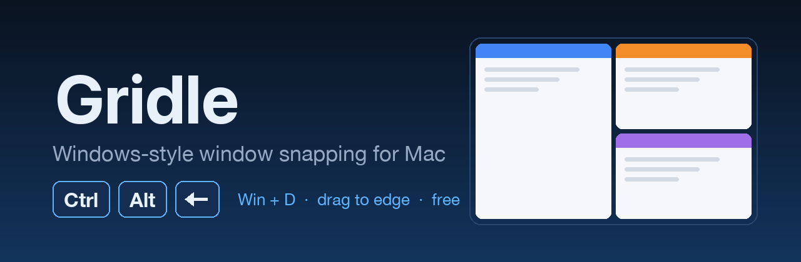
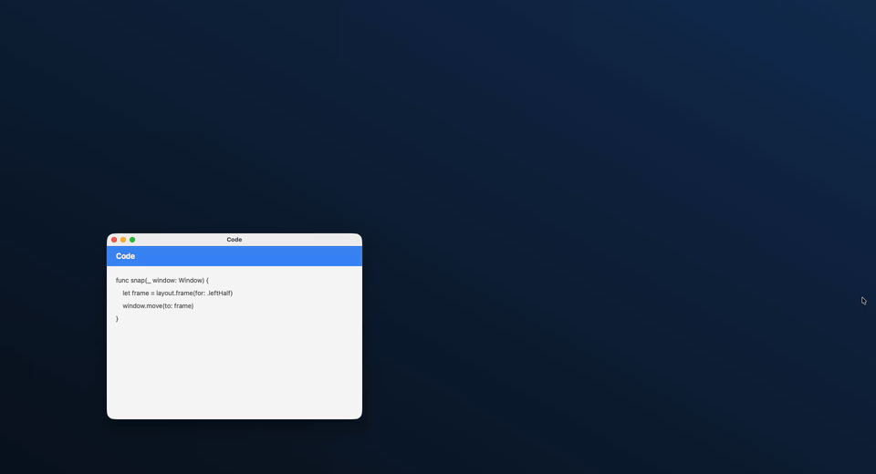

<p align="center">
  
</p>

<p align="center">
  
  
  
  
</p>

<p align="center"><b>Gridle was called Panes until version 0.2.0.</b> Same app, new name: lots of other Mac apps are called Panes.</p>

<p align="center">
  
</p>

<p align="center"><a href="https://youtube.com/shorts/_7JYDIkQlGg">▶ Watch the short</a></p>

I work on Windows, Ubuntu and a Mac every day. On Windows, <kbd>Win</kbd> + <kbd>←</kbd> snaps a window and
<kbd>Win</kbd> + <kbd>D</kbd> shows my desktop, and I never think about it. When I started using a Mac too, with a
Windows keyboard, window management became the thing I fought with every day.

So I built **Gridle**: a small, free menu-bar app, written in Swift, that moves windows the way my
hands already expect.

## ⌨️ What it does

Every key is <kbd>Ctrl</kbd> + <kbd>Alt</kbd> plus one more key. On a Windows keyboard that's exactly what's printed on
the keys, so Gridle shows them that way too: **Ctrl+Alt+←**, not Mac symbols.

| Keys | What happens |
|---|---|
| <kbd>Ctrl</kbd> <kbd>Alt</kbd> <kbd>←</kbd> / <kbd>→</kbd> | 🟦 left half / right half |
| <kbd>Ctrl</kbd> <kbd>Alt</kbd> <kbd>↑</kbd> / <kbd>↓</kbd> | 🟦 top half / bottom half |
| <kbd>Ctrl</kbd> <kbd>Alt</kbd> <kbd>Return</kbd> | ⬜ fill the screen |
| <kbd>Ctrl</kbd> <kbd>Alt</kbd> <kbd>C</kbd> | ⬜ center |
| <kbd>Ctrl</kbd> <kbd>Alt</kbd> <kbd>U</kbd> <kbd>I</kbd> <kbd>J</kbd> <kbd>K</kbd> | 🟧 top-left, top-right, bottom-left, bottom-right |
| <kbd>Ctrl</kbd> <kbd>Alt</kbd> <kbd>1</kbd> <kbd>2</kbd> <kbd>3</kbd> | 🟪 left, middle, right third |
| <kbd>Ctrl</kbd> <kbd>Alt</kbd> <kbd>D</kbd> | 🖥️ show desktop, like <kbd>Win</kbd> + <kbd>D</kbd>. Press again and exactly the apps it hid come back |
| <kbd>Ctrl</kbd> <kbd>Alt</kbd> <kbd>N</kbd> | ↪️ send the window to the next screen |

Or drag a window by its title bar to a screen edge, like on Windows: left or right edge for a half,
a corner for a quarter, the top edge to fill the screen. A preview shows where it'll land before
you let go.

### ✨ A few things I cared about

- **Small windows behave.** Some windows refuse to resize, like a settings window. Gridle still puts
  them in the corner you asked for, and `Up` only moves them up. It doesn't slide them to the middle.
- **Every key can change.** Settings → Keys, click a key, press a new combination. Gridle refuses a
  combination that's already taken and tells you which action has it.
- **An ignore list** for apps you never want moved.
- **Gaps** between windows, from 0 to 24 points.

Open Gridle again from Spotlight while it's running and Settings comes up.

I'm also working on a Pro edition with automatic stacking and saved layouts. It isn't out yet. This
repo is the free one, and it stays free.

## 📦 Install

A signed download is coming soon, so you'll be able to just unzip it and drag Gridle to Applications.
Until then, you can build it yourself. You need macOS 14 or newer and Xcode.

```
git clone https://github.com/joyahmed/gridle.git
cd gridle
sh scripts/build-app.sh
```

That builds `Gridle.app`, signs it with your own Apple Development certificate, puts it in
`~/Applications`, and starts it. The first time, macOS asks to let Gridle control your computer:
turn it on in System Settings → Privacy & Security → Accessibility. That's how any window manager
moves other apps' windows.

If you use Rectangle, quit it first. It uses the same keys. If macOS's own tiling shows a preview
when you drag to an edge, you can turn it off in System Settings → Desktop & Dock → Windows.

## ✅ Checking it

```
sh scripts/verify.sh
```

Build, unit tests and the style check, in a few seconds. The window math lives in its own module
(`GridleCore`) with no Mac UI code in it, so it's tested without moving a single window.

```
open -n -W --stdout /tmp/gridle-selftest.txt ~/Applications/Gridle.app --args --selftest
```

The self-test opens its own test windows and moves them through every snap, including a window
that can't resize. It never touches your real windows.

## 🐞 Found a problem?

Open an issue with your macOS version, how many screens you have, and which app's window misbehaved.

## 📄 License

Copyright (C) 2026 the Gridle authors (see [AUTHORS](AUTHORS)). Gridle is free software under the GNU General Public License v3:
you can use it, change it and share it, and any copy you share stays under the same license.
See [LICENSE](LICENSE).

---

<p align="center">Made by <a href="https://github.com/joyahmed">joyahmed</a> at <a href="https://zettabyteincorp.com/open-source/gridle">ZettaByte</a></p>
